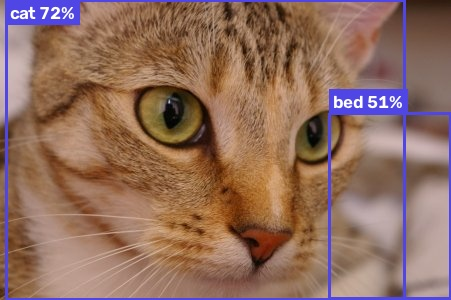
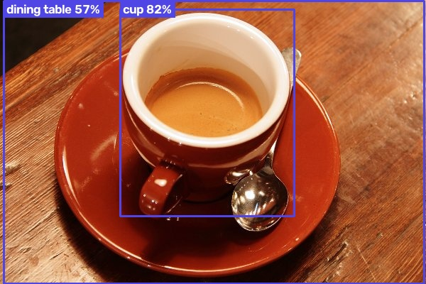

# Object Detection with OpenCV and SSD MobileNet v3

Detects and labels everyday objects (people, cars, animals, cups and 76 other COCO classes) in **images and live webcam video**, using a pretrained **SSD MobileNet v3** model through OpenCV's DNN module. Runs on a laptop CPU in real time.


| Input | Result |
|---|---|
| Street scene |  |
| `samples/cat.jpg` |  |
| `samples/coffee.jpg` |  |

## Features

- Detects **80 kinds of objects** (people, vehicles, animals, food, furniture and more) with confidence scores
- Works on **image files and live webcam video**, in real time on a laptop CPU
- **Command-line tool** that shows, saves or prints detections as JSON, with an adjustable confidence threshold
- **Reusable `ObjectDetector` class** for your own code
- Correct COCO label mapping, checked by tests

## How it works

1. Loads the frozen TensorFlow graph and its config into `cv2.dnn_DetectionModel`.
2. Resizes each frame to 320×320, scales pixels to [-1, 1] and swaps BGR to RGB to match how the model was trained.
3. Keeps detections above a confidence threshold, removes overlapping duplicates with non-maximum suppression, and draws a labeled box for each.

**A bug worth knowing about:** the model returns COCO class ids from 1 to 90, and that id space has gaps (there is no id 12, 26, 29 and so on). Many tutorials pair it with an 80-name label list, which shifts every label after id 11, so a cat is reported as a "dog" and a cup as a "banana". `labels.txt` here has all 90 slots with `N/A` in the gaps, and a test checks the mapping.

## Run it

```bash
pip install -r requirements.txt

python detect.py samples/cat.jpg                  # show the image with boxes
python detect.py samples/cat.jpg --save out.jpg   # save the annotated image
python detect.py samples/cat.jpg --json           # print detections as JSON
python detect.py                                  # live webcam, press q to quit
python detect.py --confidence 0.6                 # only confident detections
```

Example JSON output:

```json
[
  { "label": "cat", "confidence": 0.722, "box": [6, 0, 398, 299] }
]
```

**Use it in your own code**

```python
import cv2
from detector import ObjectDetector, draw

detector = ObjectDetector()
image = cv2.imread("photo.jpg")
for d in detector.detect(image, min_confidence=0.5):
    print(d.label, d.confidence, d.box)
cv2.imwrite("annotated.jpg", draw(image, detector.detect(image)))
```

## Tests

```bash
pip install -r requirements-dev.txt
pytest
```

The tests check the label mapping, that the model finds the cat and the cup in the sample images, that a blank image gives no detections, threshold and sorting behaviour, drawing, and the command-line options. GitHub Actions runs them on every push.

## Project structure

| File | Description |
|---|---|
| `detector.py` | `ObjectDetector` class, `Detection` result type and `draw()` |
| `detect.py` | Command-line tool for images and webcam |
| `frozen_inference_graph.pb`, `ssd_mobilenet_v3_large_coco_2020_01_14.pbtxt` | Pretrained model (COCO) |
| `labels.txt` | COCO class names by id, 1 to 90 |
| `samples/` | Test images and their annotated results |
| `tests/` | pytest suite |

Sample images `cat.jpg` and `coffee.jpg` come from the scikit-image example data set (public domain / CC0).
